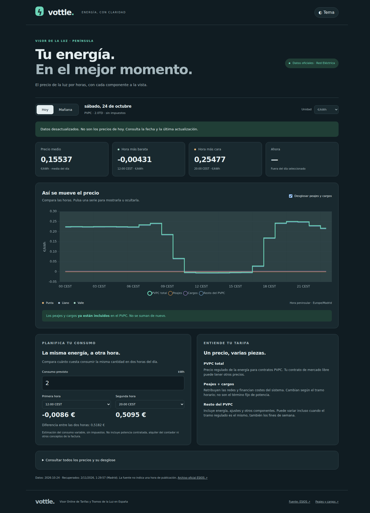

# vottle

**Visor Online de Tarifas y Tramos de la Luz en España** · [English below](#english)

Dashboard estático de precios horarios PVPC: gráfico interactivo, peajes, cargos y resto,
resumen diario, comparación del coste de consumo y tabla accesible. HTML, CSS y JavaScript
sin frameworks; Python genera JSON validado desde ESIOS. Sin cuentas, cookies ni analítica.



## Inicio (una sola vez)

Instala Git y Nix con flakes habilitados (Linux o macOS). El flake soporta x86_64 y
ARM64 en Linux, y Apple Silicon en macOS; la verificación de este proyecto se realiza en Linux x86_64.
Para activación automática, instala direnv y nix-direnv, configura el hook de direnv en
tu shell y añade `source /ruta/a/nix-direnv/share/nix-direnv/direnvrc` a `~/.config/direnv/direnvrc`
según tu instalación. Después:

```sh
direnv allow
just update
just dev
```

Alternativa sin direnv ni paquetes Python/Node globales:

```sh
nix develop
just update
just dev
# O directamente:
nix develop --command just check
```

Abre http://127.0.0.1:8000. Los cambios en `web/` reconstruyen automáticamente el sitio;
recarga el navegador para verlos. `just demo` permite trabajar sin ESIOS con datos
sintéticos **marcados como demostración**; Nix debe disponer ya de sus dependencias.
El sitio muestra un gráfico central con tres series, cuatro estadísticas y dos tarjetas
para la calculadora y explicación. Sigue el tema del sistema y permite cambiarlo.

## Comandos

| Comando               | Función                                           |
| --------------------- | ------------------------------------------------- |
| `just`, `just --list` | Ayuda                                             |
| `just dev`            | Servidor local y reconstrucción al editar fuentes |
| `just fetch`          | Descargar y validar hoy y mañana                  |
| `just build`          | Generar `dist/` usando los datos descargados      |
| `just update`         | Descargar y construir                             |
| `just demo`           | Construcción con fixtures sintéticos etiquetados  |
| `just test`           | Tests Python y JavaScript sin red                 |
| `just lint`           | Ruff, nixfmt, actionlint y sintaxis JS            |
| `just fmt`            | Formatear Python, Nix y frontend                  |
| `just check`          | Todos los controles                               |
| `just clean`          | Eliminar datos descargados, salida y cachés       |

## Datos y límites

Fuente: [ESIOS PVPC](https://www.esios.ree.es/es/pvpc), archivo 70:
`https://api.esios.ree.es/archives/70/download_json?locale=es&date=YYYY-MM-DD`.
La respuesta examinada el 2 de noviembre de 2026 tiene raíz `PVPC`, fechas `Dia`,
intervalos `Hora`, y precios `PCB` y `TEUPCB` con coma decimal en €/MWh. Se dividen
por 1000 para obtener €/kWh. Los campos fuente permanecen en los fixtures de prueba;
el JSON público conserva las etiquetas originales y el agregado regulado publicado.
Las entradas sintéticas están identificadas en `tests/fixtures/README.md`.

Cobertura inicial: **Península**, horario `Europe/Madrid`, tarifa 2.0TD, campos PCB.
No extrapolamos el calendario peninsular a Canarias, Ceuta o Melilla. El cambio de hora
produce 23 o 25 intervalos, diferenciados por offset y CET/CEST. Las fechas consultadas
se calculan en Madrid, independientemente del sistema o navegador.

`config/tariffs.json` contiene vigencia y fuentes para 2026. Los importes oficiales son:

| Tramo | Peajes €/kWh | Cargos €/kWh |
| ----- | -----------: | -----------: |
| Punta |     0,033261 |     0,064292 |
| Llano |     0,016409 |     0,012858 |
| Valle |     0,000077 |     0,003215 |

Referencias: [CNMC, peajes 2026](https://www.boe.es/diario_boe/txt.php?id=BOE-A-2025-26348),
[MITECO, cargos y peajes](https://www.miteco.gob.es/es/energia/energia-electrica/electricidad/peajes.html),
[Circular 3/2020, periodos](https://www.boe.es/buscar/act.php?id=BOE-A-2020-1066).
Punta: 10–14 y 18–22; llano: 8–10, 14–18 y 22–24; valle: 0–8, fines de semana,
6 de enero y festivos nacionales de fecha fija no sustituibles. No se incluyen Viernes
Santo, festivos autonómicos, municipales ni traslados de festivos al lunes.
Sin configuración vigente el proceso falla: cada año exige revisar las nuevas normas.

Peajes y cargos **ya forman parte del PVPC**. El resto se calcula como total menos
ambos componentes, manteniendo precios negativos. El gráfico no apila series.
En los archivos de otoño, las etiquetas fuente pueden numerar los 25 intervalos
de `00-01` a `24-25`; el parser verifica la secuencia completa y la asigna a los
instantes reales, conservando `source_hour`.

ESIOS redondea TEUPCB a 0,01 €/MWh; se admite una diferencia máxima de
0,000005 €/kWh contra los valores reglamentarios de seis decimales.
La tabla conserva toda la precisión configurada. Las horas más baratas y caras se
calculan por PVPC total, no por tramo. En empates se muestra la primera hora.

El cálculo es consumo × precio horario, sin potencia fija, contador ni impuestos.
Se omite la estimación fiscal opcional. PVPC no equivale a una tarifa de mercado libre,
y el coste variable no es la factura completa. El archivo no declara una fecha/hora de
publicación: mostramos su fecha de validez y la hora de recuperación, sin inventarla.

## Actualización y GitHub Pages

La ejecución automática valida, descarga, construye y publica con las acciones oficiales
de Pages. Se ejecuta al cambiar `main`, manualmente y a las **21:30 Europe/Madrid**
(con `timezone` de GitHub Actions, incluido el cambio de hora). No hay Python en el navegador
ni llamadas desde el navegador a ESIOS. Todos los recursos usan rutas relativas.

Para publicar (acción inicial del propietario):

1. Usa el repositorio público [gonzaponte/vottle](https://github.com/gonzaponte/vottle)
   y sube los cambios a su rama `main` (`git push -u origin main`).
2. En **Settings → Pages → Build and deployment**, selecciona **GitHub Actions**.
3. Permite las acciones del workflow y los despliegues del entorno `github-pages`.
4. Ejecuta **Actions → Publish dashboard → Run workflow**.
5. Abre [gonzaponte.github.io/vottle](https://gonzaponte.github.io/vottle/)
   (o la URL que indique Pages).

No se necesita PAT ni commits diarios de datos. El job de construcción solo lee el
repositorio; el job de despliegue recibe `pages: write` e `id-token: write`.
En PR se comprueba una construcción de demostración, nunca se publica.

Si falla hoy, hay datos incoherentes o se agotan los tres intentos HTTP de 20 segundos,
el workflow falla **antes de subir el artefacto**: Pages conserva el despliegue anterior.
La interfaz avisa si la fecha de esos datos ya no es hoy. Si mañana responde 404/422 o
un archivo vacío se indica que aún no está publicado; otros errores abortan la actualización.
Una recuperación manual es volver a ejecutar el workflow. Los fallos aparecen en Actions;
no hay servicio adicional de monitorización. GitHub puede retrasar o descartar ejecuciones
y desactivar cron tras 60 días sin actividad en repositorios públicos: reactiva el workflow
y ejecuta una actualización manual. Si Pages da 404, comprueba origen Actions, permisos,
artefacto y URL con el nombre del repositorio. No publiques `just demo` como datos reales.

## Estructura

```text
flake.nix / flake.lock / .envrc  Entorno reproducible
justfile                       Comandos
config/tariffs.json             Importes anuales y referencias
vottle/                        API, precios, CLI, build y servidor local
web/                           HTML, CSS y módulos JavaScript
nix/                           Derivación Chart.js con hash fijo
tests/                        Tests y fixtures deterministas
.github/workflows/             CI y Pages
data/ → dist/                 Datos descargados → salida generada (ignorados por Git)
```

MIT para el código propio. Chart.js mantiene su licencia MIT original, incluida en la
salida. Las fuentes y licencias de terceros están documentadas en `nix/README.md`.
Los precios se atribuyen a Red Eléctrica/ESIOS; la licencia del código no otorga derechos
adicionales sobre los datos oficiales. No hay recursos remotos en tiempo de navegación.

## English

vottle is a lightweight Spanish PVPC electricity dashboard for mainland Spain. It shows
hourly total prices, regulated network tariffs, system charges, remaining components,
daily statistics and a consumption cost comparison. The Spanish interface supports light
and dark themes, accessible tables and 23/25-hour DST days. Energy prices exclude taxes
and fixed contracted-power charges. Regulated components are already included in PVPC.

**Setup:** install Nix with flakes enabled. Optionally install direnv and nix-direnv,
configure their shell hooks and run `direnv allow`. Otherwise use `nix develop`.
Run `just update`, then `just dev`; open http://127.0.0.1:8000. No globally installed
Python/Node packages, npm install, pip install, Docker or backend server are required.
`just demo` builds an explicitly labelled synthetic demonstration without contacting ESIOS.
The command table above covers all recipes; `just check` runs offline deterministic tests
and static checks. `just fmt` formats Python, Nix and frontend sources. Chart.js is pinned and supplied by Nix.

**Architecture:** Python downloads ESIOS archive 70, validates dates, intervals, decimal
values and regulated decomposition, then atomically writes a versioned JSON bundle.
The static build copies it and frontend assets to `dist/`. Prices are converted from
EUR/MWh to EUR/kWh using decimal arithmetic. Each available day includes the source URL,
retrieval timestamp, validity date, timezone and tariff references. Tomorrow being
unpublished is distinct from a failed or malformed request. No fabricated fallback is used.

**Deployment:** use the public [gonzaponte/vottle](https://github.com/gonzaponte/vottle)
repository, push `main` (`git push -u origin main`), select GitHub Actions in
Settings → Pages, and run the Publish dashboard workflow. The expected URL is
[gonzaponte.github.io/vottle](https://gonzaponte.github.io/vottle/). Pushes, manual dispatch and a timezone-aware
21:30 Madrid schedule run checks, fetch official prices and deploy using official Pages
actions. No PAT or generated-data commits are needed. Failed acquisition leaves the prior
site deployed; stale dates are visibly flagged. Retry manually in Actions after an outage.
GitHub can delay scheduled jobs or disable them after 60 days of public-repository inactivity.

**Maintenance:** annual regulated rates and source references live in `config/tariffs.json`.
Unknown years fail rather than reuse old rates. Update the configuration against the BOE
before the year changes. Regional/municipal and substituted holidays are excluded from
the national tariff calendar. Mainland time rules are not extrapolated to other territories.
Intel macOS is excluded because the locked nixpkgs no longer supports it.
Tax estimates are intentionally omitted; this is not a complete bill or a free-market quote.
See the Spanish sections for rates, source links, troubleshooting and repository layout.

**License:** MIT for project code, with Chart.js's original MIT license shipped separately.
Official data is attributed to Red Eléctrica/ESIOS.

### Optional browser smoke test (Linux)

After `just demo`, run the browser check with Chromium supplied by the same locked nixpkgs:

```sh
nix shell --inputs-from . nixpkgs#chromium --command nix develop --command node scripts/browser-smoke.mjs
```

It checks a repository-subpath URL, chart rendering, detailed components, consumption input,
theme, mobile overflow and unpublished tomorrow, and regenerates `docs/preview.png`.
The committed preview uses genuine historical data with a visible stale-date warning.
